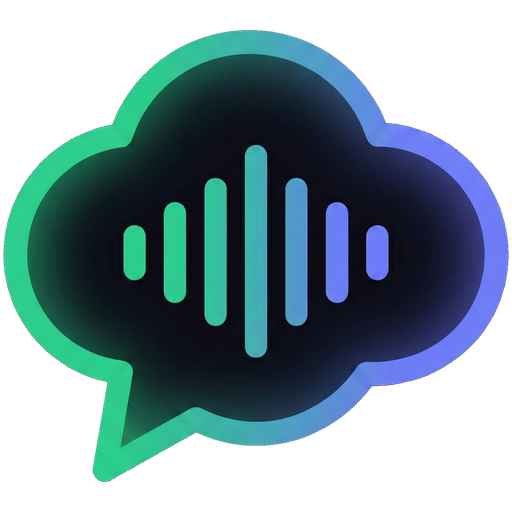
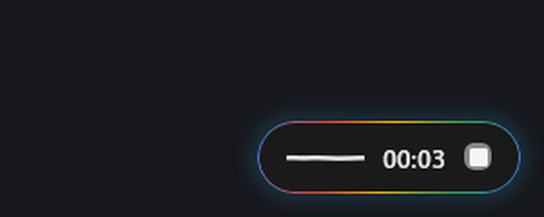
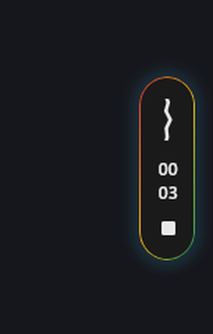
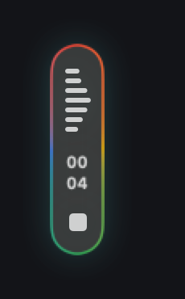
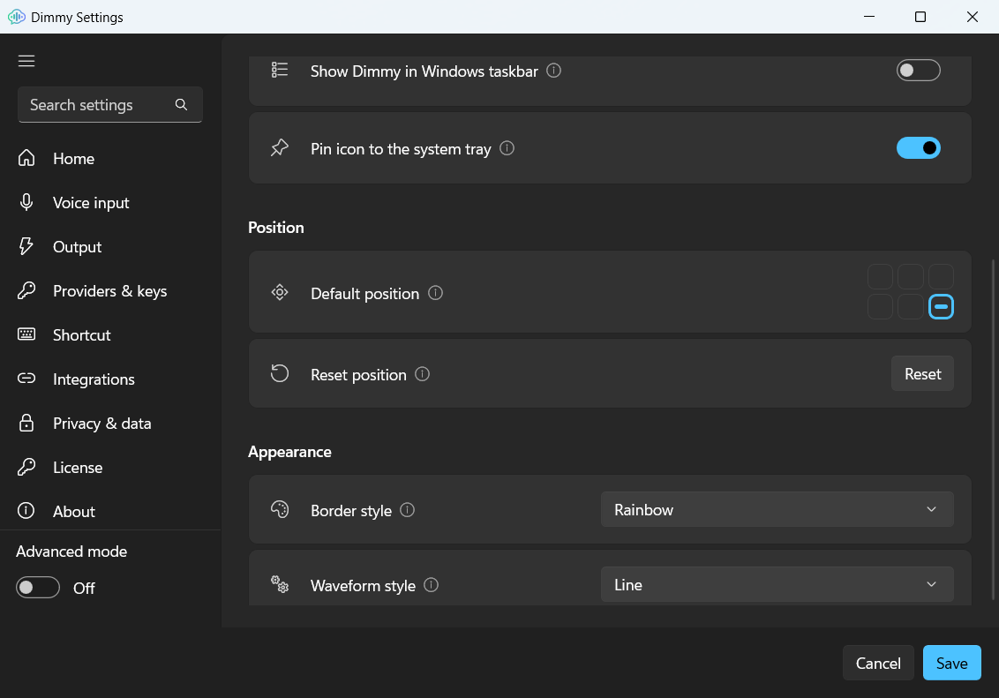
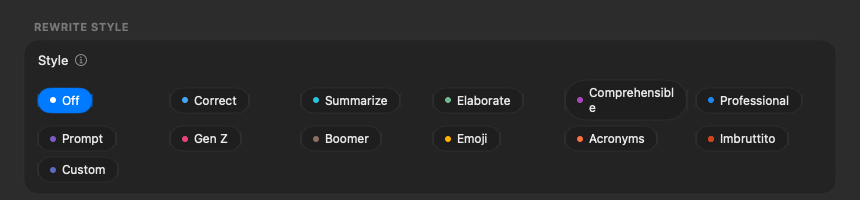
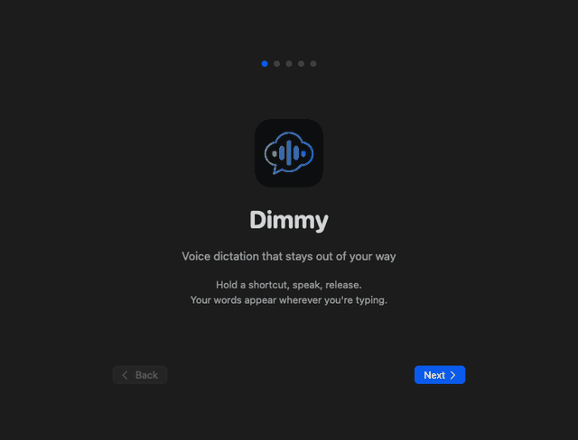
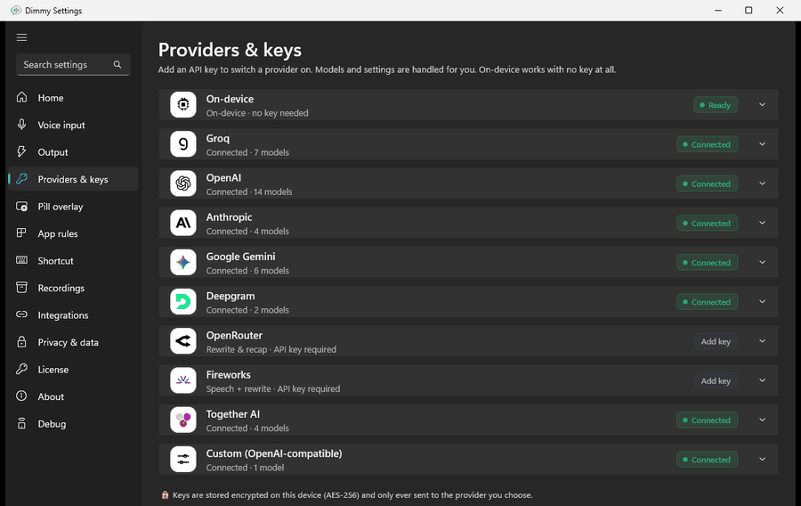
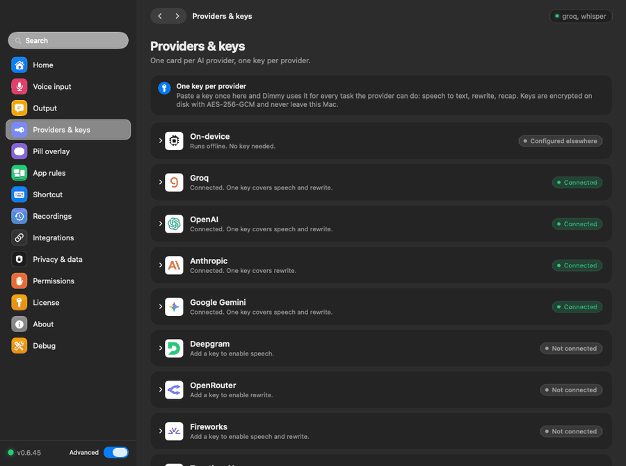
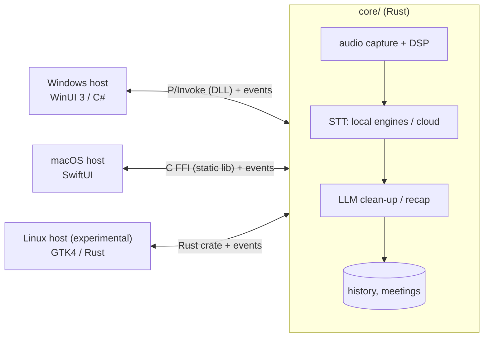

<p align="center">
  
</p>

<h1 align="center">Dimmy</h1>

<p align="center">
  <strong>Speak instead of typing.</strong><br>
  Voice dictation into any app, and meeting notes without a bot, for Windows and macOS.<br>
  Speech recognition on your computer or with the cloud provider you choose.
</p>

<p align="center">
  <a href="https://github.com/KonradDallaOrg/dimmy/actions/workflows/ci.yml"></a>
  <a href="https://github.com/KonradDallaOrg/dimmy/releases/latest"></a>
  <a href="LICENSE"></a>
  
</p>

<p align="center">
  <a href="https://dimmy.app"><strong>Website</strong></a> ·
  <a href="https://github.com/KonradDallaOrg/dimmy"><strong>GitHub</strong></a> ·
  <a href="https://huggingface.co/KonradDallaOrg"><strong>Hugging Face</strong></a> ·
  <a href="https://github.com/KonradDallaOrg/dimmy/releases/latest"><strong>Download</strong></a> ·
  <a href="https://dimmy.app/install.md"><strong>Install with your AI</strong></a> ·
  <a href="PRIVACY.md"><strong>Privacy</strong></a> ·
  <a href="CONTRIBUTING.md"><strong>Contribute</strong></a>
</p>

<table>
  <tr>
    <th>Windows</th>
    <th>macOS</th>
  </tr>
  <tr>
    <td width="50%" align="center"></td>
    <td width="50%" align="center"></td>
  </tr>
</table>

Press a shortcut and speak. A small pill shows that Dimmy listens. Release the keys, and the text goes into the app that has focus. Dimmy can also record a whole call and write a recap.

The name is pronounced "Dimi", from the Italian *dimmi*, "tell me".

## The pill

The pill stays on top of your other windows. Drag it to a corner or to the middle of a screen edge, and it snaps there. On the left and right edges it turns vertical. While you drag, the zones where it can dock show on the screen. Point at the pill to open it: the recording view then shows the time (mm:ss) and a stop button.

<table>
  <tr>
    <th>Drag and dock (Windows)</th>
    <th>Docked in a corner (Windows)</th>
  </tr>
  <tr>
    <td rowspan="3" width="40%" align="center" valign="top"></td>
    <td align="center"></td>
  </tr>
  <tr>
    <th>Docked on a side, vertical (Windows | macOS)</th>
  </tr>
  <tr>
    <td align="center"> </td>
  </tr>
</table>

Border style, waveform style and the default position are in **Settings → Pill overlay**.

<p align="center">
  
</p>

## Features

**Dictation**

- Text goes into any app: editors, browsers, chat, terminals.
- Hold-to-talk or toggle, on a shortcut that you set.
- **Streaming dictation**: text appears while you speak (Deepgram or OpenAI Realtime in the cloud, or local chunked transcription).
- Filler-word removal in six languages (English, Italian, Spanish, French, German, Portuguese).
- Custom dictionary for names and terms that the recognizer gets wrong.
- Searchable history. Drop an audio file to transcribe it.

**Speech recognition**

- Five local engines. They need no key, and no internet after the model download:
  - **whisper.cpp**, on the GPU through Vulkan (Windows) or Metal (macOS).
  - **Parakeet TDT v3**, on the Apple Neural Engine on macOS.
  - **Qwen3-ASR**, through llama.cpp.
  - **Whistle**, a small CPU-only model (about 17 MB) for seven languages.
  - **Nemotron**, real streaming with language detection and live speaker labels.
- Cloud providers: Groq, OpenAI, Deepgram, Google Gemini, Together, Fireworks, or any OpenAI-compatible endpoint.

**AI clean-up (optional)**

- 13 styles (for example Correct, Summarize, Professional, Prompt, Custom), four tones, and translation into a target language.
- **Per-app rules**: the style changes with the app that has focus.
- **Command mode**: select text, press the command shortcut, say what to change, and Dimmy replaces the selection.
- Three ways to run the language model:
  - an API key (OpenAI, Anthropic, Google Gemini, Groq, OpenRouter, Together, Fireworks, or a custom URL);
  - a subscription that you already have, through the official `claude`, `codex` or `gemini` CLI on your computer (Dimmy does not read their credential files);
  - a local model through llama.cpp (default: Gemma 4 E2B).

<p align="center">
  <picture>
    <source media="(prefers-color-scheme: light)" srcset="docs/readme/styles-mac-light.png">
    
  </picture>
</p>

**Meetings**

- Records your microphone and the system audio. No bot joins the call.
- Pause and resume. The audio goes to disk first, so a slow transcription never costs you the recording.
- Live transcript, then a structured recap: summary, decisions, action items.
- **Speaker labels** ("who said what"), which you can rename.
- Detects calls and offers to record. Shows a recording-consent notice and keeps a local log of it.

**Integrations**

- **Claude Desktop**: Dimmy installs an MCP server, so Claude can search your meetings.
- **Notion** and **Confluence**: send a recap to a page.
- **Folder export**: write each recap as Markdown to a folder, for example an Obsidian vault.
- **Telegram**: share a voice note to your "Saved Messages", and Dimmy transcribes it.
- **Subscriptions**: Claude Code, Codex and Gemini CLIs (see above).

## Platforms

| Platform | UI | Status |
|---|---|---|
| **Windows 10 / 11** (x64) | WinUI 3 | Supported. Full feature set. |
| **macOS 14+** (Apple Silicon) | SwiftUI | Supported. Full feature set. Intel Macs are not supported. |

Each UI is native. All the logic is in one shared Rust core, so a feature works the same way on both platforms.

A GTK4 Linux build also exists. It is an experimental, dictation-only prototype, and it is not maintained.

## Install

Download from the [latest release](https://github.com/KonradDallaOrg/dimmy/releases/latest):

| Platform | File | Notes |
|---|---|---|
| Windows | `Dimmy-win-Setup.exe` | Signed. Per-user install, no administrator prompt. Installs .NET 8 if it is missing. Updates itself. |
| Windows (portable) | `Dimmy-win-Portable.zip` | Needs the [.NET 8 Desktop Runtime](https://dotnet.microsoft.com/download/dotnet/8.0). |
| macOS | `Dimmy-macos-arm64.dmg` | Signed with a Developer ID and notarized by Apple. Drag Dimmy to Applications. |

**With your AI assistant.** In Claude Code, Codex or Gemini CLI, paste:

> Install Dimmy for me by following https://dimmy.app/install.md

The assistant downloads and checks the installer, sets the options with you, and runs a test. You grant system permissions and sign in yourself. No key or password goes through the chat. For agents: [`docs/dev/agent-setup.md`](docs/dev/agent-setup.md).

## Quick start

1. Start Dimmy. The setup opens.
2. Grant microphone access (and Accessibility on macOS).
3. Choose a shortcut. The default is `Win`+`Alt` on Windows and `Cmd`+`Option` on macOS.
4. Choose local or cloud recognition. A local model needs no API key.
5. Hold the shortcut, speak, and release. Dimmy pastes the text into the app that has focus.

<p align="center">
  <picture>
    <source media="(prefers-color-scheme: light)" srcset="docs/readme/onboarding-mac-light.gif">
    
  </picture>
</p>

For a cloud provider, add a key in **Settings → Providers & keys**. One key per provider covers speech, clean-up and recaps.

<table>
  <tr>
    <th>Windows</th>
    <th>macOS</th>
  </tr>
  <tr>
    <td width="50%" valign="top">
      <picture>
        <source media="(prefers-color-scheme: light)" srcset="docs/readme/settings-win-light.png">
        
      </picture>
    </td>
    <td width="50%" valign="top">
      <picture>
        <source media="(prefers-color-scheme: light)" srcset="docs/readme/settings-mac-light.png">
        
      </picture>
    </td>
  </tr>
</table>

## Privacy

- **Local recognition**: your audio and text stay on your computer.
- **Cloud recognition or a cloud model**: Dimmy sends the audio or text over HTTPS only to the provider that you chose. That provider's terms apply.
- **Subscription CLIs**: Dimmy gives the prompt to the `claude`, `codex` or `gemini` CLI on your computer. The CLI then talks to its own service.
- **API keys** are in a local file (`keys.enc`), encrypted with a key derived from your user and computer name. This is obfuscation, not a secure vault: another computer cannot read the file, but malware that runs under your account can.
- **Usage statistics and crash reports** are off until you say yes (from version 0.7.14). They never include audio, transcripts, prompts, keys, file paths or device names.
- **Licence check** (official builds only): Dimmy contacts the licence server to start a trial and to refresh the licence.

What is sent, and to whom: [`PRIVACY.md`](PRIVACY.md).

## Licence and plans

Dimmy is free software under the [GNU AGPL-3.0](LICENSE).

- **Build from source**: free, with every feature. A build without an embedded licence key has no licence check.
- **Paid plans** (Pro, and Lifetime when it is offered) give you signed builds, automatic updates and e-mail support. Pro has a 14-day trial. Prices are on [dimmy.app](https://dimmy.app/#pricing).

## For developers

One Rust core, three native hosts:



The hosts send settings with `dimmy_set_config_json` and get state changes through one event callback. Only the core writes `config.json`.

Check that your environment works:

```bash
git clone https://github.com/KonradDallaOrg/dimmy.git
cd dimmy && ./scripts/install-hooks.sh
cd core
cargo fmt --check
cargo clippy --features local-stt,local-llm -- -D warnings
cargo test --lib --features local-stt,local-llm
```

Windows: build the DLL with the full feature set every time. A missing feature breaks the engine that a user has configured, at runtime and without a build error.

```powershell
cd core
cargo build --release --lib --features local-stt-vulkan,local-stt-parakeet,local-llm-vulkan,denoise-gtcrn,local-stt-qwen
cd ..
dotnet build platforms/windows/Dimmy.Windows/Dimmy.Windows.csproj -c Debug -p:Platform=x64
```

Keep `-p:Platform=x64`. Without it, the output goes to a different folder and the app keeps loading the old DLL.

macOS: run `scripts/dev/preflight-mac.sh`. It builds the Rust static library, runs `xcodebuild`, and starts the app for 5 seconds so that the start-up self-tests run.

| Read | For |
|---|---|
| [`CONTRIBUTING.md`](CONTRIBUTING.md) | First PR, rules, pre-push checklist |
| [`docs/BUILD.md`](docs/BUILD.md) | Every build, test and lint command, all feature flags |
| [`docs/ARCHITECTURE.md`](docs/ARCHITECTURE.md) | Layer map, data flow, FFI |
| [`docs/dev/development-practices.md`](docs/dev/development-practices.md) | Code rules: assertions in release builds, TDD, platform parity |
| [`docs/dev/testing.md`](docs/dev/testing.md) | Test tiers and how to run them |
| [`docs/dev/known-bugs.md`](docs/dev/known-bugs.md) | Read before you touch audio, macOS FFI or Windows transparency |
| [`docs/dev/windows-ci.md`](docs/dev/windows-ci.md) | Read before you edit a workflow |
| [`docs/RELEASING.md`](docs/RELEASING.md) | Cutting a release |
| [`CLAUDE.md`](CLAUDE.md) | Playbook for AI coding agents |

## Acknowledgements

[whisper.cpp](https://github.com/ggerganov/whisper.cpp) and [llama.cpp](https://github.com/ggerganov/llama.cpp) (Georgi Gerganov and contributors), [NVIDIA Parakeet and Nemotron](https://huggingface.co/nvidia), [Qwen3-ASR](https://huggingface.co/Qwen), [ONNX Runtime](https://onnxruntime.ai/), [cpal](https://github.com/RustAudio/cpal), [nnnoiseless](https://github.com/jneem/nnnoiseless), [dagc](https://github.com/audiojs/dagc) and [Velopack](https://velopack.io/). Third-party licences: [`core/assets/THIRD_PARTY_NOTICES.md`](core/assets/THIRD_PARTY_NOTICES.md).

## Links

- Website: [dimmy.app](https://dimmy.app)
- Source code: [github.com/KonradDallaOrg/dimmy](https://github.com/KonradDallaOrg/dimmy)
- Hugging Face: [huggingface.co/KonradDallaOrg](https://huggingface.co/KonradDallaOrg). This organisation keeps pinned mirrors of the speech and language models that Dimmy can download. Today the app downloads the full-precision Nemotron model from it. It downloads the other models from their upstream repositories, at pinned revisions where the code pins one.

## Support and contact

- Bugs and feature requests: [GitHub issues](https://github.com/KonradDallaOrg/dimmy/issues).
- Security reports: e-mail **security@dimmy.app** (see [`SECURITY.md`](SECURITY.md)). Do not open a public issue.
- Everything else: **hi@dimmy.app**.
